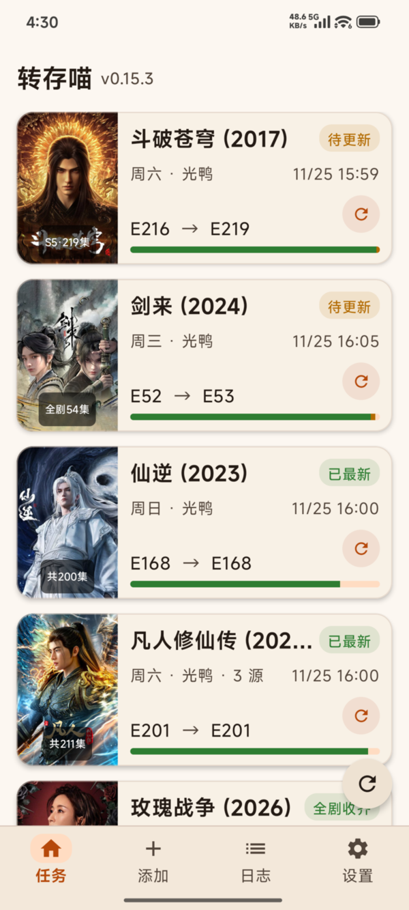
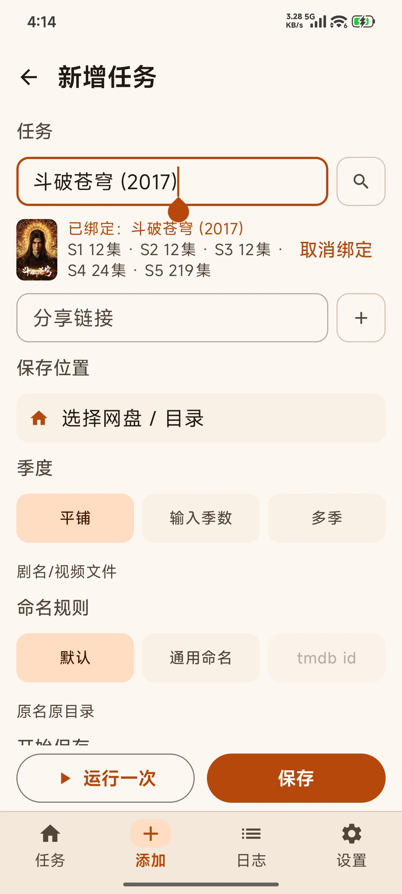
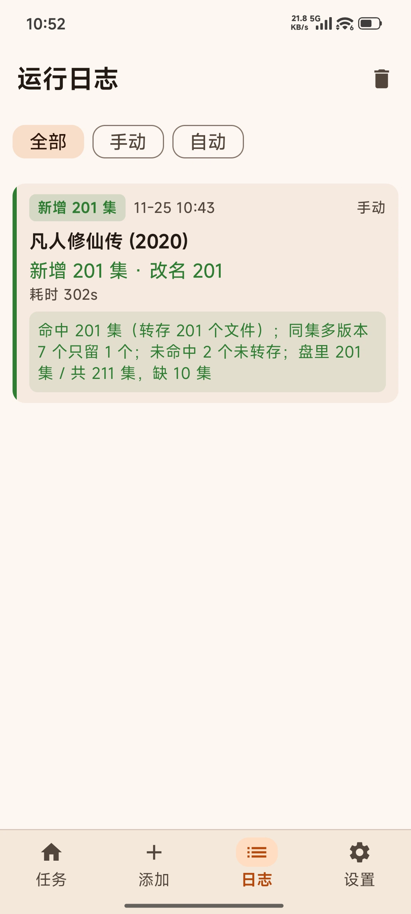
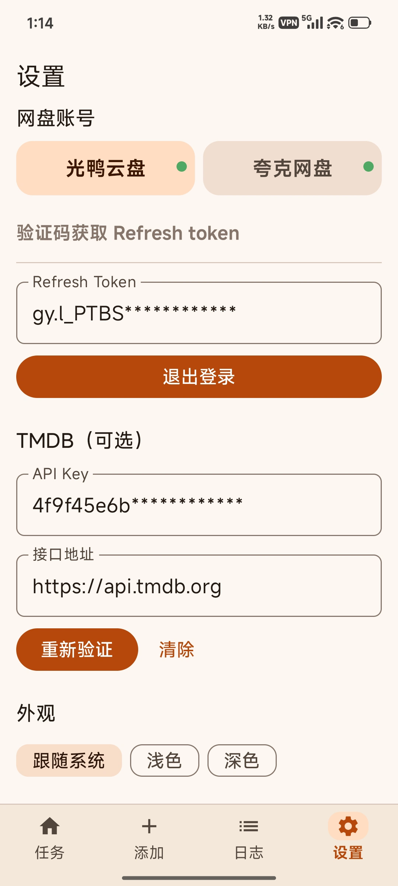
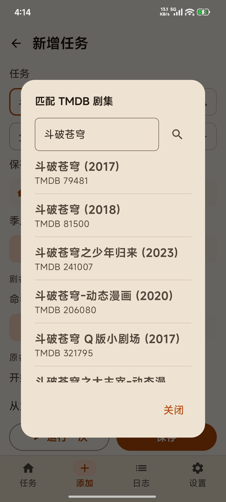

# 转存喵（TransferCat）

**开发目的：不是每个人家里都有 NAS。** 别人分享的夸克 / 光鸭链接，用一台手机就能转存进自己的网盘，命名、分季、追更一次做完——不需要 PC、不需要 Docker、也不需要服务器。

**来源说明**：接口协议与「按目录树同名同步、只补新集」的思路借鉴自 **cloud-auto-save-x（CASX）** 项目；由此开发的安卓 App，适应更多样的分享目录结构，并加入更多易用功能。

- GitHub：<https://github.com/ASH-C776/zhuancun-miao>（源码、Issue、Releases）
- Gitee 镜像：<https://gitee.com/kijeye/zhuancun-miao>（国内访问更快，App 内更新优先走这边）

## 📥 下载

| 渠道 | 地址 |
| --- | --- |
| Gitee（国内推荐） | <https://gitee.com/kijeye/zhuancun-miao/releases/latest> |
| GitHub | <https://github.com/ASH-C776/zhuancun-miao/releases/latest> |

安装包约 2MB。已装旧版不用卸载：App 启动后自己检查新版本，弹窗点「更新」即可覆盖安装（同签名，数据不丢）。

## 一、自动转存

- 粘贴一条分享链接，选好保存目录，一键把整个分享**连目录结构一起**搬进自己的网盘（夸克 / 光鸭都支持）
- 深层目录自动进到最后一层找视频，不会只转外层空壳；转存完立刻批量改名
- 一个任务可挂 **1~5 条链接**（主源 + 备用源），某条失效不耽误其它源
- 打开 App 或点右下「全部检测」，所有任务按更新日自己跑一遍，不用逐个点

## 二、刮削友好的命名，TMDB 信息不会对错

- 命名直出主流刮削器认的标准格式：**`剧名.S01E01.mkv`**，配 `Season 1` 分季目录——Infuse、VidHub、网易爆米花这类按 `SxxExx` + 季目录识别的播放器都能直接刮对
- 绑定 TMDB 后剧名自动带年份（`律界战争 (2026)`），同名翻拍不会刮成另一部
- 想更稳可选 `tmdb id`：目录名写成 `剧名 tmdb-12345`，刮削器直接按 ID 命中，连重名歧义都没有
- 三种命名档位随时切：原名原目录 / 通用命名 / `tmdb id`
- 集数从文件名里识别（`S01E05`、`E05`、`EP05`、`第5集` 都认），扩展名原样保留

## 三、追剧：对比云盘和分享，只有新集才动手

- 每次运行都拿**分享链接里的文件列表**跟**云盘目标目录里已有的集数**对一遍，只补差集，已存在的直接跳过
- 不是覆盖重下，也不是整目录重建：旧集不动、文件夹不重复，追到第 20 集时目录里仍然只有一份文件
- 进度在任务卡片上一眼看：`E7 → E7(共19)` + 进度条 + 最近同步时间
- 更新日：周一到周日多选 + 播出时刻；点一下就是「查有没有新的，有就补上」

> 目前是「打开 App / 手动点一下」触发，后台定时自动更新还没做（方案见 `docs/auto-sync-plan.md`，待拍板）。任务卡上的「自动」指更新日由 TMDB 推断，不是无人值守。

## 补充功能

- **登录**：光鸭 App 内手机号 + 短信验证码（含人机验证），Token 过期自动刷新；夸克内置 WebView 一键取 Cookie，也留手动粘贴兜底；凭证走 Android Keystore 加密（AES-256），界面脱敏；单账号纯本地，无服务端
- **界面**：暖橘奶油 M3 Expressive，深浅色可切（自动/亮/暗）；底部四栏 任务 / 添加 / 日志 / 设置；主页只留一个右下圆形按钮，左手拇指够得到；能用图标就不写字、一屏可见
- **季度三档**：平铺 / 指定季 / 多季（`Season 0` 是特别版，不是平铺）
- **日志**：每次运行留档（转存 / 改名 / 跳过 / 失败数与原因），失败原因可展开看
- **自更新**：GitHub 与 Gitee 双端 Release，版本更高才弹窗，一天最多查一次，同版本优先 Gitee，失败静默

## 🖼 截图

| 任务列表 | 新增任务 |
| --- | --- |
|  |  |

| 运行日志 | 设置 |
| --- | --- |
|  |  |

| TMDB 匹配（可选） |
| --- |
|  |

## 🛠 构建

环境：JDK 17、Android SDK 34、Gradle 8.14.5（AGP 8.7.3 / Kotlin 2.0.21 / KSP）。

```bash
gradle :app:assembleRelease    # 混淆裁剪后的正式包，约 2MB
gradle :app:testDebugUnitTest  # 141 项单元测试
```

版本号口径固定为三段数字，`versionCode = major*10000 + minor*100 + patch`。`app/build.gradle.kts` 里的 `appVersionName` 与客户端更新检测用**同一公式**，改一边必须改另一边。

## 🚀 发版

```powershell
pwsh -File tools\publish-release.ps1 -Notes "vX.Y.Z 的更新说明"
```

脚本会：读版本号 → `assembleRelease` → **同一份 APK** 同时建 GitHub 与 Gitee 的 Release 并上传附件。令牌优先取环境变量 `GITHUB_TOKEN` / `GITEE_TOKEN`，其次读 `~/.git-credentials`。

发版约定：tag 用 `vX.Y.Z`、`prerelease`/`draft` 必须为 false、必须挂 `.apk` 附件，且发出的包与已装包同包名同签名（本项目 release 复用 debug keystore，可覆盖安装）。

## 🧱 工程结构

```
app/src/main/java/com/ashchan/cloudsaver/
├── core/adapter      # 网盘适配器接口（登录 / 解析 / 列目录 / 转存 / 改名）
├── core/model        # DriveFile / ShareNode / 季号与集数解析 / 命名规则
├── core/tmdb         # TMDB 搜索与播出日推断
├── drive/guangya     # 光鸭：Token 登录、分享解析、转存、改名
├── drive/quark       # 夸克：Cookie 登录、分享解析、转存、改名
├── data/             # Room（任务 / 快照 / 运行记录）+ 仓库层
├── transfer/         # 同步引擎：目录树定位、增量比对、分季、季号判定、任务执行
├── rename/           # 批量改名与限流退避
├── storage/          # 凭证加密存储、规则与 TMDB 配置
├── ui/               # Compose 界面（任务列表 / 添加 / 日志 / 设置 / 关于）
└── update/           # 自更新：Release 检测、下载校验、安装器拉起
```

逐版本的改动与验证记录见 [CHANGELOG.md](CHANGELOG.md)。

## 声明

个人自用的小工具，仅供学习与自用；请遵守各网盘服务条款。夸克 / 光鸭接口非官方公开，随时可能变化，失效会在版本更新里跟进。
