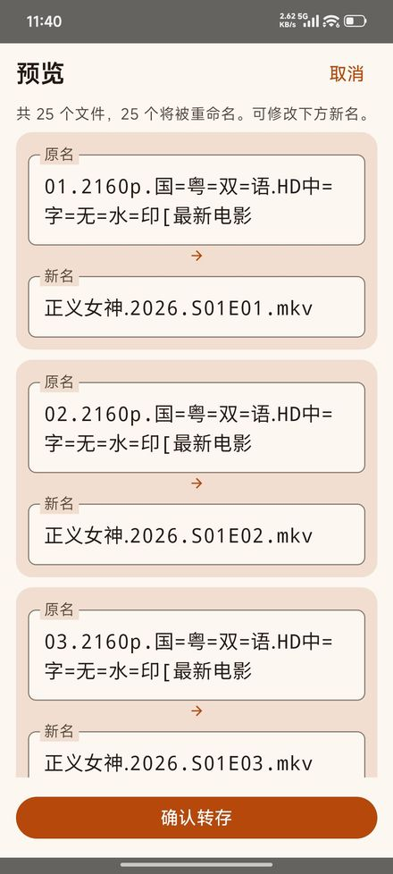
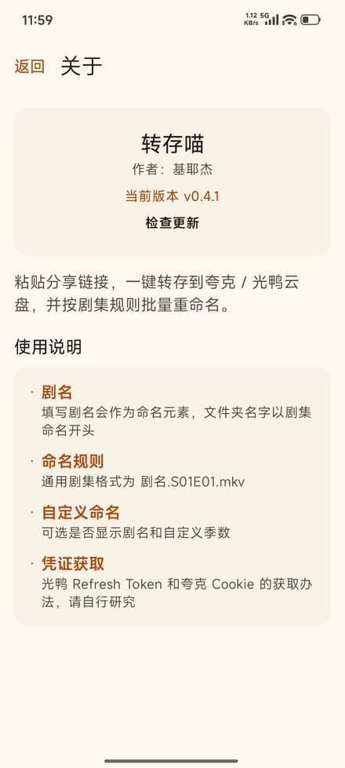

# 转存喵

网盘分享链接一键转存 + 剧集批量重命名的 Android 小工具。

粘贴 **夸克网盘 / 光鸭云盘** 的分享链接，选择转存路径与命名规则，即可把分享内容整个转存到自己的网盘，并把剧集文件按 `剧名.S01E01.mkv` 的格式批量重命名。

## ✨ 功能

- 支持夸克网盘、光鸭云盘
- 分享链接一键转存到指定目录
- 命名规则：通用剧集命名（`剧名.S01E01.mkv`）/ 保持原名 / 自定义（剧名开关 + 季度选择）
- 转存前预览「原名 → 新名」，支持单条手改
- **增量转存**：追剧重复转存同一部剧时，自动识别目标文件夹里已有的集数（`S01E05` / `E05` / `EP05` / `第5集` 均可识别），预览里灰显标「已存在 · 跳过」，只补新集，不再生成重复文件夹
- **转存记录**：每次转存自动存档（剧名 / 时间 / 网盘 / 路径 / 规则 / 成功失败数），支持「再转一次」一键回填链接与剧名，最多保留 50 条
- 暖橘奶油 · M3 Expressive 界面，深浅色主题（自动 / 亮 / 暗）
- 凭证加密存储，界面脱敏显示
- 内置检查更新：新版本发布后「关于」页自动提示
- 光鸭：App 内「验证码获取」手机号 + 短信一键登录，自动回填 Refresh Token
- 夸克：App 内「获取 Quark Cookie」内置 WebView 登录页一键取 Cookie，免手动抓包

## 📥 下载

- **Releases 页面**：<https://github.com/ASH-C776/zhuancun-miao/releases>
- **直接下载 APK**：[zhuancun-miao-v0.6.0.apk](https://github.com/ASH-C776/zhuancun-miao/releases/download/v0.6.0/zhuancun-miao-v0.6.0.apk)（约 1.9MB）
  - 国内直连 GitHub 不畅时，可用加速链接：[ghfast.top 加速下载](https://ghfast.top/https://github.com/ASH-C776/zhuancun-miao/releases/download/v0.6.0/zhuancun-miao-v0.6.0.apk)
- 或自行克隆本仓库构建：`gradle :app:assembleRelease`

## 🖼 截图

| 转存预览 | 关于 |
| --- | --- |
|  |  |

## 🚀 使用

1. 设置 → 登录网盘：光鸭可点「验证码获取」用手机号 + 短信验证码一键登录并自动回填 Refresh Token；夸克可点「获取 Quark Cookie」在内置登录页一键取 Cookie。也可手动粘贴 Token / Cookie。
2. 主页粘贴分享链接、填写剧名、选择转存路径与命名规则
3. 开始转存 → 预览确认 → 完成
4. 追剧补集：链接换成新一集的分享，剧名保持不变，预览里已有的集会灰显「已存在 · 跳过」，确认后只追加新集到原文件夹；想重下某集，勾选它右侧的复选框即可

> 小技巧：主页顶栏的列表图标是「转存记录」，里面每个历史任务都有「再转一次」，点一下自动回填链接和剧名，不用再翻聊天记录找分享链接。

## 🛠 构建

用 Android Studio 打开 `AndroidApp` 目录，或：

```bash
cd AndroidApp
gradle :app:assembleRelease   # 混淆裁剪后的安装包（约 1.9MB）
```

### 工程结构

```
app/src/main/java/com/ashchan/cloudsaver/
├── core/
│   ├── adapter/CloudDriveAdapter.kt   # 统一网盘适配器接口（登录/解析/列文件/列目录文件/转存/重命名）
│   └── model/                         # DriveFile / ShareInfo / RenameRule / TransferResult
├── drive/
│   ├── guangya/                       # 光鸭：GuangYaApi + GuangYaAdapter（Token + 自动刷新）
│   ├── quark/                         # 夸克：QuarkApi + QuarkAdapter（Cookie，移动端分享兼容）
│   └── DriveFactory.kt                # 按网盘类型创建适配器
├── rename/                            # 规则引擎：filter/rename、占位符填充、合法性校验
├── storage/                           # 凭证加密存储 / 自定义规则持久化 / 转存记录持久化（RecordStore）
├── transfer/TransferManager.kt        # 转存→拿新 fileId→重命名 流程编排（限流间隔）
└── ui/                                # Compose 页面（暖橘奶油 M3 主题）
```

## ⚠️ 声明

接口均为非官方逆向接口，可能随官方改版失效；本项目仅供个人学习与效率工具用途，请遵守对应网盘的服务条款。

---

作者：基耶杰
